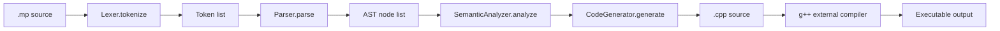
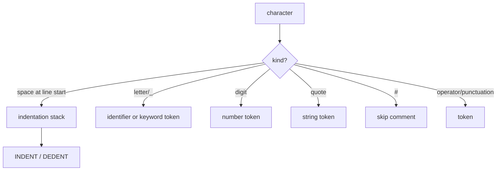
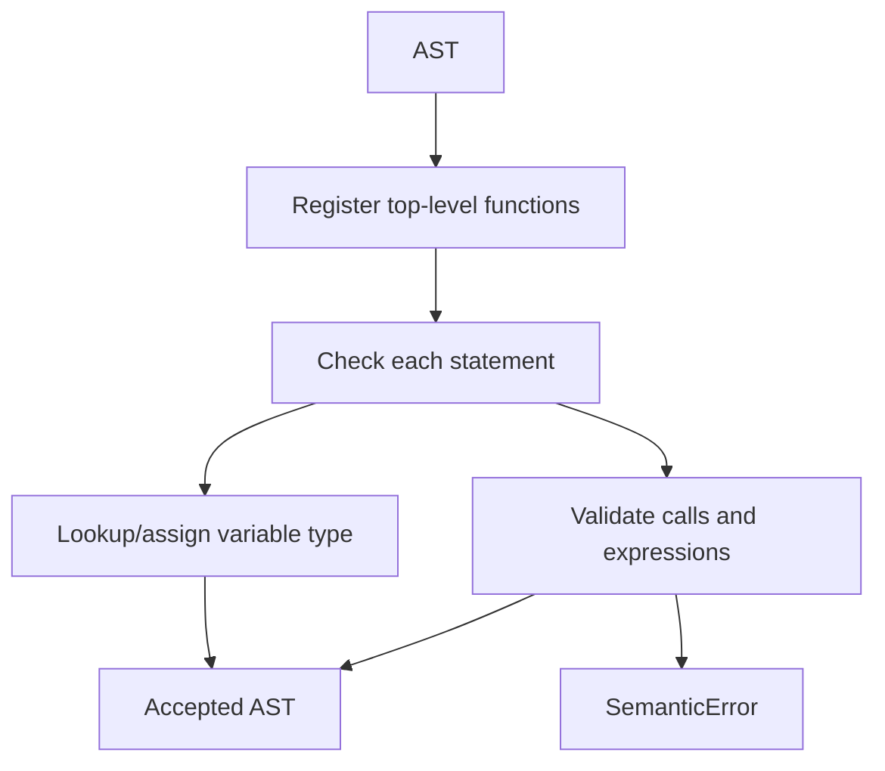
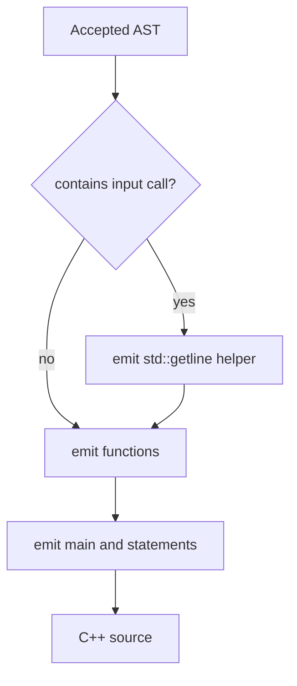

# MiniPy technical audit

Audit date: 2026-11-02. Evidence is the current working tree, its tests, sample programs, generated C++, and local `g++` execution.

## Purpose and architecture

MiniPy is an educational Python-like to C++ source-to-source transpiler. Its scope is assignments, scalar literals, expressions, printing, zero-argument string input, `if/else`, `while`, `for range`, and constrained integer functions. It does not produce machine code.

| Module | Input and processing | Output / dependencies |
|---|---|---|
| `lexer.py` | `Lexer` scans source characters, recognizes keywords, strings, numbers, comments, and indentation. | `Token` list; used by parser. |
| `parser.py` | `Parser` consumes tokens through `eat()` and precedence-level methods. | AST dataclasses from `ast.py`. |
| `ast.py` | Defines dataclasses such as `AssignmentNode`, `BinaryOpNode`, `CallNode`, `IfNode`, and `FunctionNode`. | Shared representation for semantic analysis and generation. |
| `semantic.py` | `SemanticAnalyzer` registers functions then validates nodes, types, calls, and scopes. | `True` or `SemanticError`; imports AST classes. |
| `codegen.py` | `CodeGenerator` traverses accepted AST nodes. | C++ string; imports AST classes. |
| `__main__.py` | Reads path, runs all stages, writes sibling `.cpp`. | CLI result or printed exception. |

## Algorithms

`Lexer.tokenize()` is a single character scan. Pseudocode: `while not EOF: if line-start handle indentation; classify current character; append token or raise SyntaxError; append final NEWLINE, remaining DEDENTs, EOF`. `_read_string()` accepts escapes; `_skip_comment()` skips to newline.

`Parser.parse()` repeatedly calls `statement()`. Its methods are recursive descent: `expression -> logical_or -> logical_and -> comparison -> arithmetic_expression -> term -> unary -> primary`. Binary levels loop, giving left associativity. `block()` reads statements until DEDENT/EOF.

`SemanticAnalyzer.analyze()` first records top-level `FunctionNode`s, then calls `check_statement()` for all nodes. `variables` holds globals; `local_variables` holds the current function scope. `check_scoped_block()` snapshots a scope and discards newly introduced names after a C++ block. `check_expression()` returns `int`, `float`, `string`, `bool`, `range`, or `unknown`; `check_call()` validates `range`, `input`, and user functions.

`CodeGenerator.generate()` emits includes, conditionally emits `minipy_input`, emits functions, then emits `main`. It uses `declared_variables` and `variable_types` to choose declaration or reassignment. Expressions recursively map MiniPy operators to C++ operators. `input()` maps to `minipy_input()`.

## Complexity

Let `n` be source length, `t` token count, and `a` AST-node count. Lexer time is O(n), including indentation-stack operations, and space is O(t). Parsing is O(t) time and O(a) AST space; recursion depth is bounded by nesting/expression depth. Semantic analysis and generation are O(a) expected time with average O(1) dictionary/set lookup and O(a) auxiliary storage. This is theoretical analysis, not a benchmark.

## Feature status

| Feature | Status | Evidence / restriction |
|---|---|---|
| int, float, string, bool literals | Fully implemented | lexer, semantic `check_expression`, generator `infer_type`; no exponent literals. |
| variables and same-type reassignment | Fully implemented | semantic maps and generator declaration set. |
| arithmetic, comparison, logical operations | Fully implemented | restrictions: `%` ints; bool conditions; chained comparisons differ from Python. |
| `print` | Fully implemented | one expression only. |
| `input()` | Fully implemented | zero arguments, returns string, whole line via `std::getline`; no prompts/conversions. |
| `if/else`, `while`, `for range` | Fully implemented | range has 1–3 integer args and literal positive third step. |
| functions / returns | Partially implemented | all generated signatures are `int`; no forward prototypes; global access mismatch. |
| comments, indentation, string escaping | Fully implemented | line comments; arbitrary whitespace width; selected escapes. |
| lists, classes, input conversion, `elif`, standalone calls | Unsupported | absent grammar/AST/codegen support. |

## Error handling and verified limitations

| Stage | Example | Actual behavior |
|---|---|---|
| Lexer | `@` | `SyntaxError: Unexpected character: @` |
| Lexer | inconsistent dedent | `SyntaxError: Invalid indentation` |
| Parser | `print()` | expression parser rejects `RPAREN` as unexpected expression token |
| Semantic | `print(y)` | `SemanticError: Variable 'y' is not defined` |
| Semantic | `x = 1` then `x = "s"` | cannot assign string to variable of type int |
| Semantic | `if 10:` | condition must be boolean |
| Semantic | `input("Name")` | `input() does not accept arguments` |
| Semantic | `range(5, 0, -1)` | step must be a positive integer literal |
| C++ | function calls later-defined function | generated C++ fails: name not declared; no prototype emitted |
| C++ | function reads top-level variable | generated C++ fails: global is actually local to `main` |

Errors do not include line/column information. Nested functions parse but cannot be generated correctly. Empty blocks can be accepted although Python requires a suite. The function global-read and function-forward-call faults are the main live-demo risks; avoid these programs or fix them before presenting them as supported.

## Repository audit

Remote: `https://github.com/GauravHmm/minipy-transpiler`; branch: `main`; latest commit: `f6c50cc` (`testcases files`, 2026-10-28). At audit start, `src/minipy/__main__.py` had a formatting-only local modification and tracked `forloop.cpp` was deleted. The input implementation adds source/test/docs/example changes but does not commit or push. `docs/` was empty; `examples/` was empty; both now contain project documentation/examples. Generated C++ remains tracked for existing examples; `forloop.cpp` should be restored or intentionally removed in a future explicit cleanup commit.
